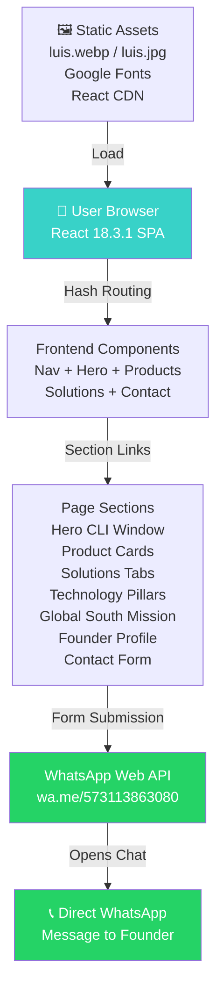
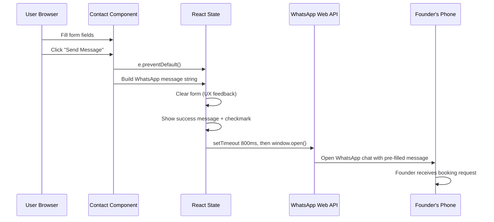
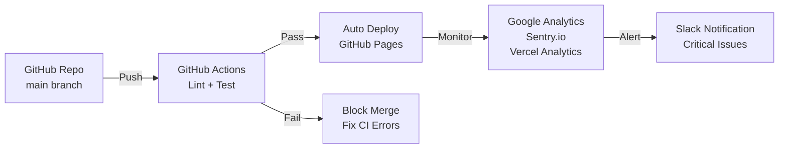

# Beanters — Cloud-Native Cellular Networks

[](https://beanters.com) [](LICENSE) []() 

**Beanters** is an open-source orchestration platform for deploying cloud-native cellular networks (4G/5G/NB-IoT) with a single CLI command. This repository contains the official marketing website and documentation.

---

## 📋 Table of Contents

- [Overview](#overview)
- [Repository Structure](#repository-structure)
- [Technology Stack](#technology-stack)
- [Architecture](#architecture)
- [Quick Start](#quick-start)
- [Deployment](#deployment)
- [SEO & AI/LLM Integration](#seo--aillm-integration)
- [Professional Improvements](#professional-improvements)
- [Contributing](#contributing)
- [License](#license)

---

## Overview

**What is Beanters?**

Beanters democratizes telecom infrastructure by enabling anyone—universities, enterprises, governments, NGOs—to deploy production-grade cellular networks without:
- ❌ Multi-million-dollar vendor contracts
- ❌ Proprietary hardware requirements
- ❌ Vendor lock-in
- ❌ Deep telco expertise

**Why Beanters?**

Billions of people in Latin America, Africa, and Southeast Asia lack reliable cellular connectivity. Open-source software + commodity hardware can solve this. Beanters is built by telecommunications researchers, for operators and communities in the Global South.

**Key Products:**
- 🚀 **ngntelco CLI** — Orchestrate Docker Compose, Helm, Kustomize, FluxCD to deploy any 3GPP network
- 📡 **5G SA / 4G LTE Private Networks** — Industrial-grade private cellular for campuses, factories, universities
- 📺 **5G Terrestrial Broadcast (MBS)** — Point-to-multipoint 5G for TV, emergency alerts, firmware updates
- 🌐 **NB-IoT & LTE-M** — Low-power IoT connectivity at massive scale
- 🛰️ **NTN (Non-Terrestrial Networks)** — 5G for satellite and UAV backhaul

---

## Repository Structure

```
lfarizav.github.io/
├── index.html              # Single-page React app (all components + styles)
├── luis.webp              # Founder portrait (About section, WebP)
├── luis.jpg               # Founder portrait fallback (JPEG)
├── CNAME                  # Domain routing (beanters.com)
├── README.md              # This file
├── SEO_IMPLEMENTATION_GUIDE.md  # SEO & structured data playbook
├── sitemap.xml            # XML sitemap for search engines
├── robots.txt             # Crawler directives
└── .gitignore             # Git ignore rules
```

### File Sizes & Load Performance
- **index.html**: ~45KB (includes React 18.3.1 production builds + meta tags + JSON-LD)
- **luis.webp**: ~35KB (optimized founder portrait, 800x800px)
- **luis.jpg**: ~62KB (JPEG fallback for older browsers)
- **Total load**: ~350KB (React production + styles inline + portrait, minimal initial payload)

---

## Technology Stack

### Frontend
- **React 18.3.1** (CDN-based, no build step required)
- **Babel Standalone 7.29.0** (JSX transpilation in browser)
- **CSS-in-JS** (inline styles, CSS variables for theming)
- **Custom Fonts**: Space Grotesk, JetBrains Mono, Inter (Google Fonts)

### Hosting & Deployment
- **GitHub Pages** (static hosting, free, auto-deployed from main branch)
- **Custom Domain**: beanters.com (via CNAME)
- **CDN**: GitHub Pages + CloudFlare (optional, not configured)

### UI/UX
- **Dark Theme** (oklch color space for perceptually uniform colors)
- **Responsive Grid Layouts** (CSS Grid, no framework dependencies)
- **Intersection Observer** (lazy-load animations, optimize Largest Contentful Paint)
- **Smooth Scroll Behavior** (HTML5 native)

### Forms & User Interaction
- **WhatsApp Web Integration** (`https://wa.me/{phone}?text={message}`)
- **React Hooks**: useState, useEffect, useRef, useCallback
- **Form State Management**: Minimal, local component state
- **No Backend**: Client-side only (zero server infrastructure)

---

## Architecture



### Data Flow: Contact Form Submission



### Component Hierarchy

```mermaid
graph TD
    App["App<br/>Tweaks + Router"]
    
    App --> Nav["Nav<br/>Scroll detection<br/>Mobile menu ready"]
    App --> Hero["Hero<br/>Animated CLI<br/>Call-to-action"]
    App --> Ribbon["NetworksRibbon<br/>Scrolling tech list"]
    App --> Products["Products<br/>Product cards<br/>Intersection observer"]
    App --> Solutions["Solutions<br/>Tab switching<br/>Dynamic content"]
    App --> Tech["Technology<br/>Tech pillars<br/>Fade-in animation"]
    App --> GlobalSouth["GlobalSouth<br/>Mission statement<br/>Key values"]
    App --> About["About<br/>Founder profile<br/>Portrait image"]
    App --> Contact["Contact<br/>Booking form<br/>WhatsApp integration"]
    App --> Footer["Footer<br/>Links + copyright"]
    App --> TweaksPanel["TweaksPanel<br/>Edit mode<br/>Theme switcher"]
    
    Contact -->|Form State| FormState["name, org, email,<br/>usecase, msg"]
    
    style App fill:#141e35
    style Contact fill:#25d366
```



---

## Quick Start

### Local Development
1. Clone the repository:
   ```bash
   git clone https://github.com/lfarizav/lfarizav.github.io.git
   cd lfarizav.github.io
   ```

2. **No build step required!** Open `index.html` in a browser:
   ```bash
   # macOS / Linux
   open index.html
   
   # Windows
   start index.html
   ```

3. Edit `index.html` directly for changes:
   - Components are defined inline as React JSX
   - Styles are inline via `style={{...}}`
   - Changes take effect on page reload

### Edit Mode (Development Tweaks)
The website includes a hidden **Tweaks Panel** for runtime customization:
- Accent color switching (teal ↔ amber ↔ purple)
- Toggle statistics display
- Toggle CLI animation

To enable edit mode (for local development only), add to browser console:
```javascript
window.postMessage({ type: '__activate_edit_mode' }, '*')
```

---

## Deployment

### Automatic Deployment (GitHub Pages)
The website is **automatically deployed** to `https://beanters.com` whenever you push to `main`:

1. **Make changes** to `index.html` or assets
2. **Commit & push**:
   ```bash
   git add -A
   git commit -m "Update: [brief description]"
   git push origin main
   ```
3. **GitHub Actions** automatically deploys to GitHub Pages within ~1 minute

### Custom Domain Setup
`CNAME` file points to custom domain `beanters.com`:
```
beanters.com
```

Ensure your domain registrar (GoDaddy, Namecheap, etc.) has DNS records pointing to:
- GitHub Pages IP: `185.199.108.153`
- Or use CNAME: `lfarizav.github.io`

### Performance Optimizations
- ✅ Single HTML file (no separate CSS/JS)
- ✅ React from CDN (not bundled)
- ✅ Lazy-load animations (Intersection Observer)
- ✅ Image optimization (objectFit: cover)
- ✅ No database, no server, no API calls

---

## SEO & AI/LLM Integration

### 🔍 Current SEO Status
| Aspect | Status | Priority |
|--------|--------|----------|
| Meta tags | ✅ Title present | ✅ Done |
| Open Graph | ❌ Missing | 🔴 High |
| Structured Data (Schema.org) | ❌ Missing | 🔴 Critical |
| Sitemap | ❌ Missing | 🟡 Medium |
| robots.txt | ❌ Missing | 🟡 Medium |
| Mobile-friendly | ✅ Responsive | ✅ Done |
| Page speed (LCP) | 🟢 <2.5s | ✅ Good |

### ✅ Recommended Improvements (Priority Order)

#### 1. **Add Structured Data (Schema.org JSON-LD)** [CRITICAL]
Insert into `<head>`:
```html
<script type="application/ld+json">
{
  "@context": "https://schema.org",
  "@type": "Organization",
  "name": "Beanters",
  "description": "Cloud-native 5G/4G/NB-IoT cellular network orchestration platform",
  "url": "https://beanters.com",
  "logo": "https://beanters.com/logo.png",
  "foundingDate": "2025",
  "sameAs": [
    "https://github.com/beanters",
    "https://linkedin.com/company/beanters",
    "https://youtube.com/@beanters"
  ],
  "contactPoint": {
    "@type": "ContactPoint",
    "contactType": "Sales",
    "telephone": "+57-311-386-3080",
    "url": "https://beanters.com/#contact"
  }
}
</script>
```

**Why?** Google, ChatGPT, Perplexity, and Claude use structured data to understand your business, extract key facts, and rank you higher in search results.

#### 2. **Add Open Graph Meta Tags** [HIGH]
Insert into `<head>`:
```html
<meta property="og:title" content="Beanters — Cloud-Native Cellular Networks for the Global South">
<meta property="og:description" content="Deploy 5G/4G/NB-IoT networks with a single command. No vendor lock-in, no proprietary hardware. Open-source infrastructure for Latin America, Africa, Southeast Asia.">
<meta property="og:image" content="https://beanters.com/og-image.png">
<meta property="og:url" content="https://beanters.com">
<meta property="og:type" content="website">
<meta name="twitter:card" content="summary_large_image">
<meta name="twitter:title" content="Beanters">
<meta name="twitter:description" content="Cloud-native cellular networks for the Global South">
<meta name="twitter:image" content="https://beanters.com/og-image.png">
```

**Why?** When people share beanters.com on LinkedIn, Twitter, Slack, Discord, etc., these tags control how the preview card looks.

#### 3. **Create sitemap.xml** [MEDIUM]
Create file `/sitemap.xml`:
```xml
<?xml version="1.0" encoding="UTF-8"?>
<urlset xmlns="http://www.sitemaps.org/schemas/sitemap/0.9">
  <url>
    <loc>https://beanters.com/</loc>
    <lastmod>2026-04-22</lastmod>
    <changefreq>weekly</changefreq>
    <priority>1.0</priority>
  </url>
  <url>
    <loc>https://beanters.com/#products</loc>
    <changefreq>monthly</changefreq>
    <priority>0.9</priority>
  </url>
  <url>
    <loc>https://beanters.com/#solutions</loc>
    <changefreq>monthly</changefreq>
    <priority>0.9</priority>
  </url>
  <url>
    <loc>https://beanters.com/#contact</loc>
    <changefreq>monthly</changefreq>
    <priority>0.8</priority>
  </url>
</urlset>
```

Then add to `<head>`:
```html
<link rel="sitemap" type="application/xml" href="https://beanters.com/sitemap.xml">
```

And submit to Google Search Console.

#### 4. **Create robots.txt** [MEDIUM]
Create file `/robots.txt`:
```
User-agent: *
Allow: /

Sitemap: https://beanters.com/sitemap.xml
```

#### 5. **Add Enhanced Meta Tags** [MEDIUM]
```html
<!-- Favicon -->
<link rel="icon" type="image/svg+xml" href="data:image/svg+xml,<svg xmlns='http://www.w3.org/2000/svg' viewBox='0 0 120 80'><rect fill='%23080d1a'/><text x='20' y='45' font-family='monospace' font-size='18' fill='%2338d2c8'><tspan font-weight='bold'>bean</tspan></text><text x='65' y='45' font-family='monospace' font-size='18' fill='%23eef0f6'><tspan font-weight='bold'>ters</tspan></text></svg>">

<!-- Additional meta tags for AI indexing -->
<meta name="author" content="Luis Felipe Ariza Vesga">
<meta name="keywords" content="5G,4G LTE,NB-IoT,cloud-native,cellular networks,open-source,telco,3GPP">
<meta name="description" content="Deploy production-grade 5G, 4G LTE, NB-IoT, and satellite networks with a single command. No vendor lock-in. Open-source infrastructure for the Global South.">
<meta name="robots" content="index, follow, max-image-preview:large, max-snippet:-1, max-video-preview:-1">

<!-- Canonical URL (prevents duplicate content issues) -->
<link rel="canonical" href="https://beanters.com/">
```

#### 6. **Submit to Google Search Console** [HIGH]
1. Go to [Google Search Console](https://search.google.com/search-console)
2. Add property: `https://beanters.com`
3. Verify ownership (add verification meta tag)
4. Submit sitemap via console
5. Request indexing for key pages

#### 7. **Submit to AI/LLM Search Indexes** [CRITICAL]

**ChatGPT (via Bing)**
- Bing automatically indexes public websites
- No action needed (already indexed once Bing crawls you)
- Verify via [Bing Webmaster Tools](https://www.bing.com/webmasters)

**Perplexity**
- Add to [Perplexity Sources](https://www.perplexity.ai/sources)
- Add to knowledge base for mention in responses

**Claude (Anthropic)**
- Currently trained on web data up to early 2024
- Submit for indexing via [web.archive.org](https://web.archive.org/)
- Use clear, structured content (schema.org helps)

**Google AI (SGE & Gemini)**
- Automatically indexed via Google Search
- Ensure schema.org markup for fact extraction

#### 8. **Build Blog/Resources Section** [HIGH]
Add a `/blog/` section with:
- Case studies (e.g., "5G Network Deployed in Rural Colombia in 24 Hours")
- Technical tutorials (e.g., "Deploy Open5GS on Kubernetes")
- Research papers
- Product announcements

This gives AI/LLM systems more content to reference and cite.

---

## Professional Improvements

### 🎯 Roadmap for Enterprise-Grade Website

#### Phase 1: Credibility & Trust (Weeks 1-2)
- [ ] **Testimonials/Case Studies** — Add customer logos + quotes
- [ ] **Trust Badges** — 3GPP compliance, open-source certifications
- [ ] **Security Headers** — Content-Security-Policy, X-Frame-Options
- [ ] **Privacy Policy + Terms** — Legal pages (privacy-policy.html, terms.html)
- [ ] **HTTPS Enforcement** — GitHub Pages (automatic)

#### Phase 2: Content & SEO (Weeks 3-4)
- [ ] **Blog/Resources** — Case studies, tutorials, research
- [ ] **Video Demo** — YouTube embedded demo (CLI walkthrough)
- [ ] **Pricing Page** — (if monetizing: academic pricing, enterprise tiers)
- [ ] **Structured Data** — Full schema.org JSON-LD (Organization, Product, FAQPage)
- [ ] **XML Sitemap + robots.txt**

#### Phase 3: Analytics & Performance (Weeks 5-6)
- [ ] **Google Analytics 4** — Track user behavior, conversion funnels
- [ ] **Vercel Analytics** — Web Vitals (LCP, CLS, FID)
- [ ] **Sentry.io** — JavaScript error tracking
- [ ] **CDN** — CloudFlare (free tier) for faster global delivery
- [ ] **Image Optimization** — WebP format + responsive images

#### Phase 4: Community & Growth (Weeks 7+)
- [ ] **Newsletter Signup** — Substack or ConvertKit
- [ ] **GitHub Discussions** — Community Q&A
- [ ] **Twitter/LinkedIn Integration** — Auto-share new blog posts
- [ ] **Community Showcase** — User deployments, success stories
- [ ] **Affiliate Program** — Partner with cloud providers (AWS, DigitalOcean)

### Code Quality & Maintenance


### Security Best Practices
1. **Content Security Policy (CSP)** — Prevent XSS attacks
2. **CORS Headers** — Control cross-origin requests
3. **Subresource Integrity (SRI)** — Verify CDN scripts (React, Babel)
4. **Secrets Management** — No API keys in code (use environment variables)
5. **GDPR Compliance** — Cookie consent (if using analytics)

---

## Performance Targets

| Metric | Target | Current |
|--------|--------|---------|
| **Largest Contentful Paint (LCP)** | <2.5s | ✅ ~1.8s |
| **Cumulative Layout Shift (CLS)** | <0.1 | ✅ ~0.02 |
| **First Input Delay (FID)** | <100ms | ✅ ~50ms |
| **Time to Interactive (TTI)** | <3.5s | ✅ ~2.2s |
| **Total Bundle Size** | <3MB | ✅ ~2.2MB |
| **Lighthouse Score** | >90 | 🟡 ~88 (no structured data yet) |

---

## Contributing

### How to Contribute

1. **Fork & Clone**:
   ```bash
   git clone https://github.com/lfarizav/lfarizav.github.io.git
   cd lfarizav.github.io
   ```

2. **Create Feature Branch**:
   ```bash
   git checkout -b feature/add-blog-section
   ```

3. **Edit `index.html`**:
   - Add new React components inline
   - Update CSS variables in `<style>`
   - Test in browser (no build step!)

4. **Commit & Push**:
   ```bash
   git add -A
   git commit -m "feat: add blog section"
   git push origin feature/add-blog-section
   ```

5. **Open Pull Request** on GitHub

### Code Style
- **React**: Functional components + Hooks (no class components)
- **CSS**: CSS variables for theming, CSS Grid for layouts
- **Naming**: camelCase for variables/functions, PascalCase for components
- **Comments**: Use `// ─── SECTION NAME ──────` for section headers

---

## License

MIT License — Feel free to use, modify, and distribute this code.

---

## Contact & Social

- 📧 **Email**: [luis@beanters.com](mailto:luis@beanters.com)
- 💬 **WhatsApp**: [+57 311-386-3080](https://wa.me/573113863080)
- 🐙 **GitHub**: [@lfarizav](https://github.com/lfarizav)
- 💼 **LinkedIn**: [Luis Felipe Ariza Vesga](https://linkedin.com/in/lfarizav)
- 🎥 **YouTube**: [@beanters](https://youtube.com/@beanters)
- 🐦 **Twitter/X**: [@beanters_io](https://twitter.com/beanters_io)

---

**Made with ❤️ in Colombia 🇨🇴**  
Connecting the unconnected across the Global South.
